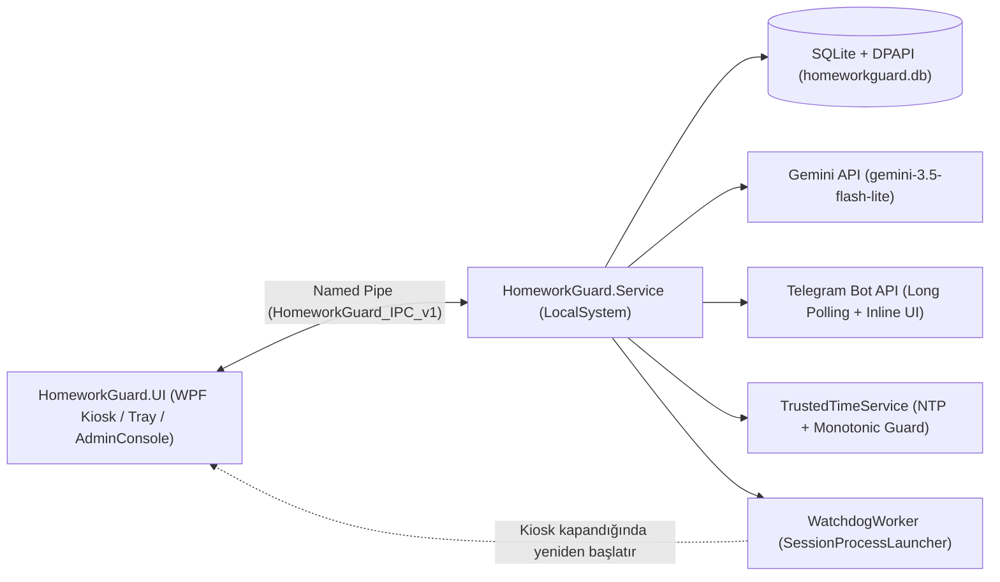

# Teknik Mimari (`ARCHITECTURE.md`)

Bu belge **HomeworkGuard** bileşenlerinin nasıl haberleştiğini, güvenlik sınırlarını ve çalışma zamanı yaşam döngüsünü açıklar.

---

## Bileşen Diyagramı

---

## Projeler ve Sorumlulukları

### 1. `HomeworkGuard.Core`
- **`AppBuildConfig`**: Derleme zamanı güvenlik anahtarı (`IS_DEV_SANDBOX_MODE`). `ProductionKiosk=true` geçilmediği sürece `true` kalır ve veri dizinini `%LocalAppData%\HomeworkGuard\DevSandbox` altında izole eder. Üretim modunda veri dizini `C:\ProgramData\HomeworkGuard` olur.
- **`IpcContracts`**: `NamedPipeIpcServer` ile `NamedPipeIpcClient` arasındaki JSON istek/yanıt veri sözleşmeleri (`GetStatus`, `SubmitHomeworkMedia`, `SubmitSocraticAnswers`, `AdminAuthenticate`, `AdminUpdateSettings`, `SetMaintenanceMode`, vb.).
- **`CryptoHelper`**:
  - Yönetici şifreleri için **PBKDF2-SHA256** (rastgele salt + sabit zamanlı karşılaştırma).
  - Gemini API anahtarı ve Telegram Bot Token için Windows **DPAPI (`ProtectedData`)** şifrelemesi.

### 2. `HomeworkGuard.Service`
- **`HomeworkGuardCoordinator`**: Tüm kilit durum makinesini (`NightLock`, `HomeworkRequired`, `UnlockedFreeTime`, `MaintenanceMode`), günlük kullanım sayacını ve iki aşamalı ödev onay akışını yönetir.
- **`GeminiHomeworkEvaluator`**:
  - `Google.GenAI` resmi .NET SDK'sını kullanır.
  - Birincil model olarak `gemini-3.5-flash-lite` ile **Structured JSON Output** (`ResponseMimeType = "application/json"`, `ResponseSchema`) kullanır.
  - Aşama 1 (`Stage1Schema`) çalışma yeterliliğini ve 2 adet Sokratik soruyu döndürür; Aşama 2 (`Stage2Schema`) öğrencinin cevaplarını değerlendirip `approved` ve `0-100` puan üretir.
- **`TrustedTimeService`**:
  - Sistem saatine ek olarak NTP sunucularından (`time.windows.com`, `pool.ntp.org`) ve HTTPS yanıt başlıklarından güvenilir zamanı doğrular; monotonic saat (`Environment.TickCount64`) ile geriye alma girişimlerini yakalar.
- **`WatchdogWorker` & `SessionProcessLauncher`**:
  - `NightLock` veya `HomeworkRequired` durumlarında `HomeworkGuard.UI.exe` sürecinin aktif kullanıcı oturumunda (`WTSQueryUserToken` + `CreateProcessAsUser`) çalıştığını denetler ve beklenmedik kapanmalarda yeniden başlatır.
- **`TamperProtectionService`**:
  - Yönetici konsolundan bakım modu açılmadan izinsiz değişiklik/kapatma girişimlerini denetler ve denetim kaydına (`AuditLog`) yazar.

### 3. `HomeworkGuard.UI`
- **`MainWindow`**: Kiosk kilit ekranı, WebView2 tabanlı whitelist eğitim tarayıcısı, sürükle-bırak / dosya seçme / web kamerası yükleme paneli, durum polling (`500 ms`) ve istek sürerken buton kilitleme koruması.
- **`LowLevelKeyboardHook`**: Üretim kiosk modunda `Alt+Tab`, `Win`, `Ctrl+Esc`, `Alt+F4` gibi çıkış kısayollarını engeller.
- **`TrayIconManager`**: `UnlockedFreeTime` ve `MaintenanceMode` durumlarında uygulamayı sistem tepsisinde (System Tray) çalıştırır.
- **`AdminAuthWindow` & `AdminConsoleWindow`**: Şifre veya Acil Kurtarma Anahtarı ile giriş yapılan yönetici ayarları ve denetim kayıtları ekranı.

### 4. `HomeworkGuard.Setup`
- `Install-Hardening.ps1` ve `Uninstall-Hardening.ps1` betiklerini kullanıcı dostu tek pencereden çalıştırır.
- Kurulum sırasında yapılan tüm kayıt defteri ve sistem ayarlarının orijinal değerlerini yedekler; kaldırma sırasında eski değerleri geri yükler.
